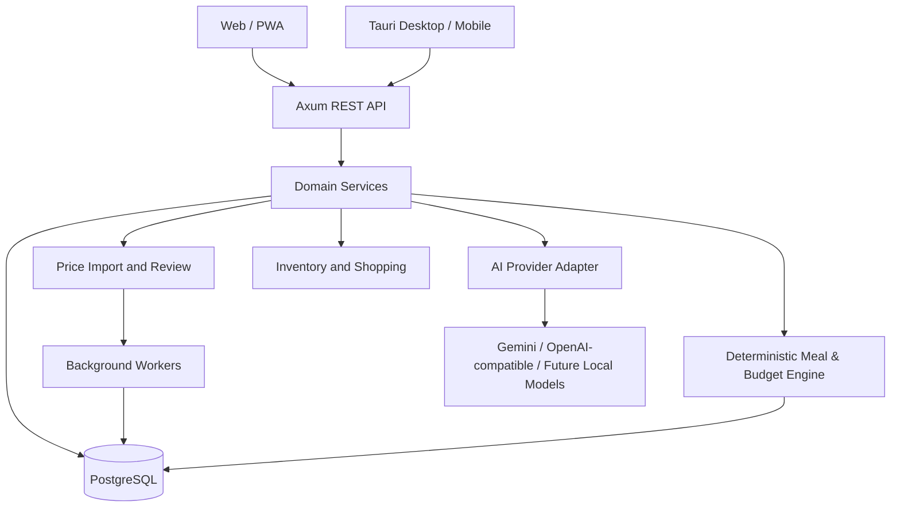

# BELHANA (بالهنا)
## Master Product, Architecture & Implementation Prompt

**Product:** بالهنا — Belhana  
**Category:** AI-assisted family food budgeting, meal planning, local price intelligence, recipes, pantry/freezer inventory, and occasion planning.  
**Initial market:** Egypt, with an architecture that can later support other Arab countries.  
**Primary language:** Arabic (Egyptian-friendly wording, full RTL).  
**Secondary language:** English (LTR).  
**Preferred stack:** Rust + Axum + SQLx + PostgreSQL + SvelteKit + TypeScript + Tauri 2.  
**Execution mode:** Implement incrementally, test each phase, and keep the application runnable.

---

# 1. Mission and product definition

You are the lead product engineer, software architect, Rust developer, SvelteKit developer, database engineer, AI integration engineer, data engineer, and quality engineer for **Belhana (بالهنا)**.

Build a cross-platform application that helps families plan and manage their food spending, choose affordable and reasonably healthy meals, track food already available at home, manage household preferences, organize shopping, and plan family gatherings ( عزومات ).

Belhana is not a generic expense tracker and not merely a recipe browser. It is a household food decision-support system that combines:

1. Household size, member preferences, exclusions, and family rules.
2. A local food product catalog and editable price observations.
3. Recipes adapted to Egyptian households and accessible ingredients.
4. A deterministic meal-planning and budget-optimization engine.
5. Shopping list calculation from the selected plan and current inventory.
6. Pantry, refrigerator, and freezer stock management.
7. Economical batch cooking, preparation, storage, and leftover guidance.
8. AI assistance for conversational requests, recipe alternatives, explanations, and plan proposals.
9. Local merchant price intelligence, initially entered manually and later connected through approved integrations.
10. Special-event and guest-meal planning with scalable quantities and per-person costs.

The product principle is:

> Help a household make the best practical combination of affordability, food variety, nutritional diversity, family satisfaction, convenience, and reduced waste using the household's actual budget, stock, preferences, and local price evidence.

The system must never invent current prices, available inventory, verified nutrition data, or source dates. Clearly distinguish verified observations, manually entered estimates, stale values, and AI suggestions.

## 1.1 Target users

- Egyptian households with different income levels.
- Household owners who plan and pay for groceries.
- Other adults who help with shopping or cooking.
- Families with children and different food preferences.
- Users who shop once or several times a week.
- Users who need economical meal planning without sacrificing food variety.
- Users planning family gatherings and special occasions.

Do not classify users with stigmatizing income labels. Let users enter a budget appropriate to their circumstances.

## 1.2 Product name and localization

The product name is **بالهنا** and its English brand spelling is **Belhana**.

Use the brand name consistently in the application, documentation, seed data, and project metadata. Keep branding configurable so the product can later be white-labelled if needed.

Arabic is the default language on first launch. The user can switch to English in settings. Use correct RTL layout, number formatting, dates, currency formatting, typography, and mixed Arabic/English text handling. Switching to English must switch the interface to LTR without corrupting stored Arabic content.

Initial country: Egypt. Initial currency: EGP (جنيه مصري). Household city and area must be configurable; do not assume every user is in the same city.

---

# 2. Critical product and data principles

1. **Prices are observations, not permanent product attributes.** A product can have many prices from different merchants and dates.
2. **Preserve raw source material.** Store the source text or a reference to it, subject to applicable rights and privacy requirements.
3. **Never silently repair ambiguous data.** Preserve what the source actually said and place uncertain fields into review.
4. **The AI is not the financial calculator.** Rust/domain logic calculates quantities, prices, totals, and budgets deterministically.
5. **The AI does not override hard rules.** Allergies, explicit food exclusions, and user-locked meals must not be violated by a generated plan.
6. **A price without a unit is not safely comparable.** Do not assume per-kilogram, per-piece, or per-package when the source does not state it. Mark the unit as unresolved and request confirmation.
7. **Old prices must not look current.** Every display of a price should have its observation date and freshness state.
8. **No fabricated nutrition facts.** Nutrition fields may be unknown; cite the data source where available.
9. **Separate cash spending from inventory value.** Using food already purchased should not be counted again as new shopping expenditure.
10. **Manual entry must be a first-class workflow.** Facebook access is a future enhancement, not a requirement for the MVP.
11. **Local popularity must be evidence-based.** Do not claim a dish is popular in a town without a data basis. Use local user votes, meal-plan selections, merchant/community contributions, and curated local suggestions, with transparent sample sizes and dates.
12. **Keep the backend independent of Tauri.** Web, desktop, Android, and iOS clients must use the same versioned backend API.

---

# 3. Technology stack and architecture

## 3.1 Preferred technologies

### Backend
- Rust stable.
- Tokio for asynchronous execution.
- Axum for REST APIs.
- SQLx for PostgreSQL access and compile-time/query validation where practical.
- Serde for serialization.
- Reqwest for approved external HTTP integrations.
- Tracing for structured logs.
- A maintained authentication/session implementation with secure password hashing and token rotation.

### Frontend
- SvelteKit.
- Svelte 5 where appropriate.
- TypeScript.
- Tailwind CSS.
- Reusable accessible components.
- RTL-first Arabic UI and English LTR UI.

### Desktop and mobile
- Tauri 2 for desktop and supported mobile targets.
- Shared Svelte UI where practical.
- Platform-specific adapters for notifications, files, camera/OCR, secure storage, and offline capabilities.
- Verify actual Android and iOS plugin compatibility before relying on a feature.

### Database
- PostgreSQL, using a currently supported stable release.
- UUID primary keys where appropriate.
- SQL migrations.
- Foreign keys, constraints, transactions, and indexes.
- JSONB only for genuinely variable metadata, not as a substitute for relational modelling.

### Local cache
- SQLite for Tauri local cache if required.
- IndexedDB for web/PWA local cache if required.
- The server PostgreSQL database is the canonical shared source of truth.

### Deployment
- Docker Compose for development and initial self-hosting.
- Separate development, staging, and production configuration.
- Automated database backup and restore tests.
- Environment-based secrets.

Start with a modular monolith plus background workers. Do not add Kafka, Kubernetes, Redis, or a separate search engine without a demonstrated need and measured benefit.

## 3.2 Suggested workspace

```text
belhana/
├── apps/
│   ├── api/                 # Rust Axum API
│   ├── web/                 # SvelteKit web app
│   ├── desktop/             # Tauri 2 desktop shell
│   └── admin/               # Optional admin UI; can initially be a protected section of web
├── crates/
│   ├── domain/
│   ├── database/
│   ├── auth/
│   ├── households/
│   ├── family_rules/
│   ├── catalog/
│   ├── units/
│   ├── merchants/
│   ├── pricing/
│   ├── recipes/
│   ├── nutrition/
│   ├── inventory/
│   ├── meal_planning/
│   ├── budget_engine/
│   ├── shopping/
│   ├── occasions/
│   ├── ai/
│   ├── source_import/
│   └── common/
├── workers/
│   ├── price_import_worker/
│   ├── notification_worker/
│   └── maintenance_worker/
├── database/
│   ├── migrations/
│   └── seed/
├── docs/
├── scripts/
│   ├── imports/
│   ├── validation/
│   └── maintenance/
├── infrastructure/
│   └── docker/
├── Cargo.toml
├── package.json
├── docker-compose.yml
├── .env.example
└── README.md
```

Adapt this structure if the repository already has a sound structure. Do not overwrite existing user work. First inspect the working directory, Git status, and existing project files.

## 3.3 Architecture diagram



---

# 4. Accounts, households, and family members

## 4.1 Accounts and synchronization

Users must be able to sign in from web, Windows/macOS/Linux desktop, Android, and iOS and see the same household data.

Implement:
- Registration and login.
- Email/password initially.
- Secure password hashing.
- Password recovery.
- Access and refresh token lifecycle.
- Logout and device/session management.
- Household membership authorization.
- Optional future Google/Apple sign-in.

The client must never connect directly to PostgreSQL. Keep API secrets and AI provider keys on the server.

## 4.2 Household profile

Fields:
- Household name.
- Country.
- City.
- Area/neighborhood (optional).
- Currency.
- Household size.
- Preferred shopping frequency.
- Weekly/monthly food budget.
- Preferred merchants.
- Kitchen equipment available.
- Household notes.

Do not assume the merchant in the supplied price post is located in Tanta or any other specific city. Merchant location must be confirmed by the user/admin.

## 4.3 Family members

Allow multiple members per household. For each member:
- Display name.
- Optional age band (avoid collecting exact birth date unless needed).
- Likes and dislikes.
- Preferred ingredients.
- Preferred dishes.
- Preferred cooking methods.
- Food allergies and exclusions.
- Dietary preferences.
- Notes.

Examples:
- Abbas likes eggplant prepared with tomato and garlic.
- Somaya likes fish prepared in a particular way.
- A household member dislikes molokhia.
- A family member prefers oven-baked food.

The user must be able to specify preferences in natural language and review the structured interpretation before it is saved.

## 4.4 Household rules

Support hard constraints and soft preferences.

Examples:
- Do not repeat the same main dish more than once within seven days.
- Do not serve fish on consecutive days.
- Include at least two legume-based meals per week.
- Use freezer stock before buying more where suitable.
- Avoid a disliked ingredient for a specific member.
- Do not include a specified allergen.
- Limit a particular dish to once every two weeks.

A hard exclusion must never be silently overridden. If rules conflict or no feasible plan exists, explain the conflict and ask the user to relax a soft preference or change the budget. Never ask the user to override a serious allergy as an ordinary planning trade-off.

Store rules structurally, for example:

```json
{
  "rule_type": "meal_repeat_limit",
  "scope": "household",
  "maximum_occurrences": 1,
  "period_days": 7,
  "priority": "hard"
}
```

```json
{
  "rule_type": "member_preference",
  "member_id": "<member-id>",
  "ingredient_id": "<eggplant-id>",
  "preparation_method": "tomato_and_garlic",
  "preference": "strong_like",
  "priority": "soft"
}
```

---

# 5. Budget management

Support:
- Daily budget.
- Weekly budget.
- Monthly budget.
- Shopping-trip budget.
- Special occasion budget.
- Optional snacks/sweets/beverages budget.
- Flexible contingency allowance.

Allow users to set category allocations, but do not force fixed percentages.

Dashboard metrics:
- Budget available.
- Planned spending.
- Actual spending.
- Remaining amount.
- Planned shopping costs.
- Actual shopping costs.
- Meal cost estimates.
- Daily/weekly/monthly history.

Support budget what-if scenarios, such as changing a weekly budget from 2,000 EGP to 1,500 EGP and regenerating alternative plans.

Use decimal-safe money types (for example integer minor units or a suitable decimal type); do not use binary floating point for money. Preserve currency and rounding rules.

Distinguish:
- Cash paid in the current shopping trip.
- Previously purchased inventory used by the plan.
- Estimated value of stock consumed.
- Actual expenses.

Do not count already-purchased inventory as a new cash expense.

---

# 6. Product catalog, merchant management, and price observations

This is a core data module.

## 6.1 Product catalog

Create products with:
- Arabic name.
- English name.
- Category and subcategory.
- Synonyms and Egyptian market names.
- Default unit, when known.
- Standard comparison unit, when valid.
- Active status.
- Optional brand/variant.
- Notes.

Initial categories:
- Vegetables.
- Fruits.
- Meat.
- Poultry.
- Fish and seafood.
- Eggs.
- Dairy.
- Legumes.
- Grains and rice.
- Flour and bakery.
- Oils and fats.
- Spices.
- Frozen products.
- Ready-made foods.
- Snacks and sweets.
- Beverages.
- Household food essentials.

## 6.2 Units and quantity conversion

Support kg, g, liter, ml, piece, dozen, carton, plate, package, bottle, bundle, and custom units.

Use dimensional conversion only where it is valid. Do not convert a plate or package into grams unless its actual net quantity is known.

If a Facebook post says "tomatoes 30 EGP" without specifying the unit, store the raw text and price but leave the normalized unit unresolved. Do not automatically treat it as 1 kg.

## 6.3 Merchants

Merchant fields:
- Name.
- City and area (unknown until confirmed).
- Address (optional).
- Public phone/contact (optional and provided legitimately).
- Facebook Page/group URL.
- Other public source URLs.
- Merchant type.
- Verification status.
- Notes.

Support multiple merchant locations.

## 6.4 Price observations

A price is a dated observation, not a permanent field on a product.

Store:
- Product and variant.
- Merchant/location.
- Amount and currency.
- Explicit unit/package size.
- Observation date/time.
- Submission date/time.
- Source type.
- Source URL/reference.
- Raw source text.
- Extracted text.
- Extraction confidence.
- Unit resolution status.
- Review status.
- Expiry/freshness status.
- Reviewer.

Suggested price states:
- `unreviewed`
- `needs_unit_confirmation`
- `needs_date_confirmation`
- `needs_product_mapping`
- `verified`
- `rejected`
- `stale`

Keep different offers from different merchants and different dates. Never overwrite historical observations.

---

# 7. First merchant seed: "محلات أولاد زين"

Import the user-provided Facebook post as the first sample merchant price-list source.

Merchant display name:

`محلات أولاد زين للخضروات والفواكة وجميع انواع الطيور الحية والمذبوحة وجميع انواع اللحوم المجمدة والمعجنات والتوابل والبقالة والماركت`

Merchant slug may be simplified to `awlad-zain`, while the original display name is preserved.

**Important source limitations:**
- The text was supplied by the user, not fetched directly from Facebook by the application.
- The exact Facebook post URL was not supplied. Leave it null until added.
- The merchant's city/area was not supplied. Do not infer it.
- The post claims: `أسعارنا لصباح اليوم السبت 14/11/2027`.
- This stated date has a weekday/date mismatch: 14 November 2027 is Sunday, while 14 November 2026 is Saturday. The application must preserve the original date text and set date status to `needs_date_confirmation`. Do not silently change it to 2026.
- The current application date when this prompt is prepared is 17 November 2026. The stated 2027 date is in the future and must not be presented as a current verified price list.
- Many prices omit their unit. Keep those prices unresolved until confirmed.
- Repeated or conflicting price entries must remain separately traceable.
- The Facebook post's promotional claims ("best quality", "cheaper than elsewhere", etc.) are merchant claims, not independently verified facts.

Create an import batch with:

```text
source_type = user_provided_facebook_post_text
merchant = محلات أولاد زين
original_date_text = السبت 14/11/2027
normalized_observation_date = null until reviewed
date_status = needs_date_confirmation
location_status = unknown
source_url = null until supplied
batch_status = imported_needs_review
```

The following table is a transcription of prices and product mentions from the supplied post. Preserve the Arabic product wording in `raw_product_label`. Map to catalog products only when the mapping is sufficiently clear.

## 7.1 Vegetables and herbs from the post

| Raw product label | Price EGP | Unit stated in post | Required handling |
|---|---:|---|---|
| طماطم جامدة جدا | 30 | Not stated | Unit needs confirmation |
| طماطم حمراء بجودة عالية | 25 | Not stated | Separate offer; unit needs confirmation |
| فاصوليا خضراء فريش | 40 | Not stated | Unit needs confirmation |
| بطاطا سكري حمراء | 20 | Not stated | Unit needs confirmation |
| ماشروم طازج فريش الطبق | 60 | Plate | Package/plate quantity unknown |
| جنزبيل فريش الطبق | 50 | Plate | Package/plate quantity unknown |
| سبانخ فلاحي فريش | 30 | Not stated | Unit needs confirmation |
| بسلة خضراء فريش بشاير | 60 | Not stated | Unit needs confirmation |
| خيار بلدي فلاحي | 30 | Not stated | Unit needs confirmation |
| بطاطس تحمير فاخر | 30 | Not stated | Unit needs confirmation |
| بطاطس وسط للسليق | 20 | Not stated | Separate grade/offer; unit needs confirmation |
| بنجر أحمر سكري الطبق | 20 | Plate | Plate quantity unknown |
| بصل أحمر إيطالي فاخر | 30 | Not stated | Unit needs confirmation |
| بصل أصفر ذهبي إيطالي | 30 | Not stated | Unit needs confirmation |
| توم أحمر بلدي | 30 | Half kg | Explicit 0.5 kg |
| ليمون أصفر فاخر | 25 | Half kg | Explicit 0.5 kg |
| جزر سكري | 30 | Not stated | Unit needs confirmation |
| كوسة فلاحي | 25 | Not stated | Unit needs confirmation |
| فلفل أخضر بلدي | 10 | Half kg | Explicit 0.5 kg |
| شطة فلاحي باردة | 10 | Half kg | Explicit 0.5 kg |
| شطة حمراء فاخر | 20 | "النص" | Likely half-unit/half-kg but confirm; do not normalize automatically |
| شطة بلدي حارة | 25 | Not stated | Unit needs confirmation |
| ملوخية فلاحي | 25 | Not stated | Unit needs confirmation |
| فلفل ألوان | 30 | Half kg | Explicit 0.5 kg |
| جنزبيل فريش | 50 | Plate in repeated mention | Same product/price repeated; keep source occurrence reference and review possible duplicate mention |
| باذنجان رومي فلاحي | 20 | Not stated | Unit needs confirmation |
| باذنجان حشو بلدي | 20 | Not stated | Separate variety; unit needs confirmation |
| كرومب حشو فلاحي | null | No price | Product mentioned, price unavailable |
| خس كابوتشي فريش | null | No price | Product mentioned, price unavailable |
| كرومب كابوتشي أحمر | null | No price | Product mentioned, price unavailable |
| كرومب كابوتشي أبيض | null | No price | Product mentioned, price unavailable |
| خضار سلطة ومحشي ونعناع وبصل أخضر وجرجير | null | حسب الطلب | Product group/service; no price |
| ملوخية مقطفة | null | No price | Prepared product; price unavailable |
| باذنجان مقور جاهز على الحشو | null | No price | Prepared product; price unavailable |
| كوسة مقورة | null | No price | Prepared product; price unavailable |
| شوربة خضار جاهزة | null | No price | Prepared product; price unavailable |

## 7.2 Fruits from the post

| Raw product label | Price EGP | Unit stated in post | Required handling |
|---|---:|---|---|
| برتقال بصرة فاخر | 40 | Not stated | Unit needs confirmation |
| جوافة بناتي رشيدي | 40 | Not stated | Unit needs confirmation |
| كنتالوب إسماعلاوي فاخر | 40 | Not stated | Unit needs confirmation |
| كاكا بشاير فاخر | 40 | Not stated | Unit needs confirmation |
| بلح أسمر رطب | 40 | Not stated | Unit needs confirmation |
| بلح برحي | 100 | Incomplete trailing text | Unit/package unclear; review |
| قشطة عبد الرزاق | 150 (was 200) | Not stated | Product identity/unit needs confirmation; promo claim not verified |
| دراجون فروت | 250 (was 350) | "من أول قطعة" | Per-piece may be implied; confirm exact unit |
| مانجو | 70 | Not stated | Unit needs confirmation |
| عنب أحمر كريمسون | 70 (was 75) | Not stated | Unit needs confirmation |
| موز بلدي | 50 | Not stated | Unit needs confirmation |
| كيوي إيطالي سوبر الطبق | 120 (was 150) | Plate | Plate quantity unknown |
| تفاح أصفر لبناني | 100 (was 120) | Not stated | Unit needs confirmation |
| تفاح أحمر سكري إيطالي | 100 (was 120) | Not stated | Unit needs confirmation |
| تفاح أخضر جرين للدايت إيطالي | 250 (was 300) | Not stated | Unit needs confirmation |

Store both current promotional amount and previous claimed amount, but do not interpret the discount as independently verified.

## 7.3 Poultry and birds from the post

| Raw product label | Price EGP | Unit stated in post | Required handling |
|---|---:|---|---|
| الفراخ البيضاء | 88 | Not stated | Per kg or per bird unclear; confirm |
| البلدي الفلاحي | 150 | Not stated | Bird type; unit unclear |
| البرابرة الفلاحي | 150 | Not stated | Bird type; unit unclear |
| الفيومي | 145 | Not stated | Bird type; unit unclear |
| الساسو | 140 | Not stated | Bird type; unit unclear |
| البط البلدي | 150 | "جميع الأوزان" | Unit/weight basis unclear |
| بط بغال سوبر | 120 | Not stated | Unit unclear |
| بط فرنساوي بيور | 100 | Not stated | Unit unclear |
| الرومي البلدي | 170 | Not stated | Unit unclear |
| الأرانب | 150 | Not stated | Unit unclear |
| الحمام | 200 / 250 / 300 / 350 | Pair, depending on size | Store size tiers and pair unit; exact mapping needs confirmation |

## 7.4 Frozen/prepared poultry products

| Raw product label | Price EGP | Unit stated in post | Required handling |
|---|---:|---|---|
| البانيه | 270 | Not stated | Likely weight-based but unconfirmed |
| استربس | 270 | Not stated | Unit unclear |
| جوردن بلو | 270 | Not stated | Unit unclear |
| شاورما | 270 | Not stated | Unit unclear |
| الوراك | 110 | Not stated | Unit unclear |
| الشيش طاووق | 270 | Not stated | Unit unclear |
| الدبابيس | 220 | Not stated | Unit unclear |
| الحمام الكداب | 220 | Not stated | Unit unclear |
| الأجنحة | 85 | Not stated | Unit unclear |
| الكبد والقوانص | 120 | Not stated | Unit unclear |

## 7.5 Grocery and pantry offers from the post

| Raw product label | Price EGP | Quantity/unit stated | Required handling |
|---|---:|---|---|
| سمنة روابي أو كريستال أو جنة أو هانم | 205 | 2 kg appears in source | Brand-to-price mapping and package interpretation need confirmation |
| زيت | 80 | 1 liter | Explicit 1 L |
| سكر | 55 | 2 kg wording appears as "2 كيلو سكر كيلو كيلو" | Preserve raw text; confirm whether total quantity is 2 kg |
| زيت حلوة وهنادي | 100 | "@"/size unclear | Needs package/unit confirmation |
| عدس | 60 | 1 kg | Explicit 1 kg |
| لوبيا | 80 | 1 kg | Explicit 1 kg |
| رز | 25 | 1 kg | Explicit 1 kg; keep separate from second rice price |
| رز | 30 | 1 kg | Explicit 1 kg; possible separate type/grade, mapping needs review |
| فيشار | 50 | Not stated | Unit/package unknown |
| حلبة بلدي | 60 | Not stated | Unit/package unknown |
| فول بلدي | 60 | Not stated | Unit/package unknown |
| توابل متنوعة | null | Not stated | No price |
| زبدة فرن | null | Not stated | No price |
| زبدة كريستال | 155 | Not stated | Package quantity unknown |
| جلاش النحراوي | null | Not stated | No price |
| رقاق النحراوي | null | Not stated | No price |
| سمبوسة النحراوي | 40 | Not stated | Package quantity unknown |

## 7.6 Frozen foods and pastry products mentioned without prices

Create catalog candidates, but do not create price observations when the post does not provide a price:

- مفروم برازيلي
- قطع برازيلي
- قطع هندي
- مفروم هندي
- كبدة إسكندراني
- بانية
- سجق مخصوص
- برجر مخصوص
- برجر جولدن بيف 20 قطعة
- برجر المذاق 20 قطعة
- سمان العابد، 2 في الطبق
- ممبار ساده العابد
- ميكس الحمد، نصف كيلو
- ميكس الحمد، ربع كيلو
- موزاريلا الحمد، نصف كيلو
- موزاريلا الحمد، كيلو
- موزاريلا الحمد، ربع كيلو
- بانيه التوابل الشرقية، 20 قطعة
- بانيه الدار، 20 قطعة
- استربس روستي
- استربس ولعتين
- مخروطه
- مصروده
- كسكسي
- جلاش
- سمبوسك
- جمبري جامبو بقشر، طبق نصف كيلو إماراتي
- جمبري لحم، نصف كيلو
- سمك فيليه
- سيفود، طبق نصف كيلو

## 7.7 Price import requirements

Build a price-list import workflow that accepts:
- Pasted Facebook post text.
- Copied post text containing emoji and HTML entities.
- Screenshot/image upload (OCR as an assistive extraction method).
- CSV/Excel files.
- Merchant-provided files.
- Future approved API data.

The workflow must:
1. Preserve the original raw text and/or uploaded source artifact.
2. Parse candidate product labels and prices.
3. Extract explicit quantities, units, package sizes, old/promotional prices, and product variants.
4. Detect ambiguous units.
5. Detect repeated lines and conflicting prices.
6. Detect dates and weekday mismatches.
7. Propose product-catalog matches.
8. Show a human review screen before saving prices as verified.
9. Preserve every correction in an audit trail.
10. Allow batch approval and rejection.

AI/OCR output is a proposal, not a verified price. Every extracted price starts unreviewed. Never infer missing unit or merchant location from convention alone.

For the initial imported post, store the original raw content provided in this prompt as an import artifact or source record, mark its date and units as described above, and do not claim the app fetched it from Facebook.

---

# 8. User-supplied baseline prices for initial seed data

In addition to the merchant observations above, the user explicitly supplied these editable baseline estimates:

| Product | Initial baseline price | Unit | Source/status |
|---|---:|---|---|
| Flour (دقيق) | 30 EGP | 1 kg | User-supplied editable baseline estimate |
| Rice (أرز) | 30 EGP | 1 kg | User-supplied editable baseline estimate |
| Meat (لحم) | 450 EGP | 1 kg | User-supplied editable baseline estimate |
| Fish (سمك) | 150 EGP | 1 kg | User-supplied editable baseline estimate |
| Eggs (بيض) | 130 EGP | Carton of 30 eggs | User-supplied editable baseline estimate |
| Sugar (سكر) | 30 EGP | 1 kg | User-supplied editable baseline estimate |
| Cooking oil (زيت) | 100 EGP | 1 liter | User-supplied editable baseline estimate |

Seed these separately from merchant observations.

For eggs, the normalized per-piece value may be calculated as 130 / 30 = approximately 4.3333 EGP per egg, but retain the original carton price and package size as authoritative input. Use decimal-safe arithmetic and appropriate rounding only when displaying or calculating a purchase.

Important conflicts to preserve:
- User baseline oil: 100 EGP/liter; Olad Zain post: 80 EGP/liter.
- User baseline rice: 30 EGP/kg; Olad Zain post contains both 25 EGP/kg and 30 EGP/kg with no distinction explaining the two offers.
- User baseline sugar: 30 EGP/kg; Olad Zain post has an ambiguous 55 EGP offer that may describe 2 kg.

Do not merge these into one price. Show source, date, unit, confidence, and status, then let the user select the preferred/current observation.

Create a settings page for editing all baseline prices. A baseline estimate must never masquerade as a verified merchant quote.

---

# 9. Recipe catalog: Egyptian and compatible Arab cooking

Build an editable recipe library adapted to Egyptian household food habits, local ingredient availability, and different budgets.

## 9.1 Recipe categories

Include:
- Egyptian traditional meals.
- Economical daily meals.
- Breakfast.
- Lunch.
- Dinner.
- Vegetarian meals.
- Legume-based meals.
- Chicken and poultry.
- Meat.
- Fish and seafood.
- Rice and pasta meals.
- Soups.
- Salads and sides.
- Homemade bakery and pastries.
- Desserts.
- Juices and beverages.
- Syrian and other Arab cuisine adaptable to Egyptian ingredients.

Examples to seed as recipe candidates (content and quantities must be written and reviewed, not invented as verified family recipes):
- فول مدمس.
- طعمية.
- شكشوكة.
- عدس.
- كشري.
- ملوخية.
- مسقعة.
- بطاطس بالصلصة.
- صينية خضار.
- أرز بالخضار.
- بيض بالخضار.
- مجدرة.
- فتة حمص.
- شاورما دجاج منزلية.
- محمرة.
- شوربات اقتصادية.

## 9.2 Recipe data model

Each recipe should include:
- Arabic name and optional English name.
- Description.
- Cuisine and meal type.
- Difficulty.
- Preparation time.
- Cooking time.
- Default servings.
- Ingredients and quantities.
- Instructions.
- Required equipment.
- Cooking method.
- Substitutions.
- Allergens where known.
- Storage/reheating notes from reliable food-safety references.
- Nutrition data with provenance when available.
- Estimated cost based on selected price observations.
- Cost per serving.
- Author/source/license metadata.
- User rating and feedback, if enabled.

Do not copy copyrighted recipe text wholesale from websites. Create original instructions or use recipes for which the necessary license/permission is available. Cite recipe sources where relevant.

## 9.3 Recipe cost engine

Calculate ingredient costs from required quantity and selected price observation.

If an ingredient has no valid unit or fresh price:
- Mark it as unknown/estimated.
- Let the user enter a manual estimate.
- Exclude or separately display incomplete cost components.
- Do not fabricate a precise total.

Separate raw recipe cost, cost per portion, and estimated shopping cash outlay after inventory deduction.

## 9.4 Cooking methods and healthy alternatives

For dishes traditionally fried, allow researched alternatives such as oven baking or air frying where technically suitable.

Explain expected differences in texture, preparation, oil quantity, and cost. Do not claim that alternatives are nutritionally identical.

---

# 10. Economical cooking, batch preparation, and food storage

Create a dedicated section called **التدبير والطبخ الاقتصادي** (Economical Cooking & Meal Prep).

It should provide practical, reusable guides such as:
- Preparing a large batch of taameya mixture and dividing it into portions.
- Preparing beans for multiple breakfasts.
- Making tomato sauce for several dishes.
- Preparing vegetables for the week's recipes.
- Using chicken and suitable stock efficiently.
- Freezer-friendly meal components.
- Reusing safe leftovers in different meals.
- Reducing preparation time and unnecessary fuel use.
- Comparing frying, baking, boiling, and grilling.
- Economical homemade desserts and beverages.

Each guide needs:
- Batch size.
- Ingredient quantities.
- Cost using current/selected price observations.
- Number of portions.
- Cost per portion.
- Preparation instructions.
- Storage container guidance.
- Freezing/refrigeration instructions.
- Defrosting/reheating guidance.
- Food-safety source and date.

Never invent food-safety storage durations. Use current reliable food-safety guidance and cite it in the content.

Allow the user to convert a batch-preparation result into an inventory lot with preparation date, quantity, storage location, and planned portions.

---

# 11. Pantry, refrigerator, and freezer inventory

Create an inventory module for:
- Pantry/cabinets.
- Refrigerator.
- Freezer.
- Other custom locations.

Each stock lot should store:
- Product.
- Quantity and unit.
- Storage location.
- Purchase/preparation date.
- Opened date if relevant.
- Expiration/use-by date if available.
- Source of quantity (manual, shopping receipt, recipe batch, adjustment).
- Estimated historical cost (optional).
- Notes.

Support:
- Add/edit stock.
- Consume a quantity.
- Move between locations.
- Correct an error with an audited adjustment.
- Expiry reminders.
- FIFO/FEFO suggestions where applicable.
- Freezer search.
- Inventory valuation as an estimate.
- Food waste recording.

Do not assume a user-entered expiry date proves food is safe. Show safety guidance and user responsibility clearly.

The meal planner must consider stock before creating a shopping list. It should not deduct inventory merely because a proposed plan exists. Deduct only when the user confirms consumption or marks the planned meal as prepared, according to a configurable workflow.

---

# 12. Meal planning engine

This is a central business component.

Do not let an LLM perform all calculations. Build a deterministic, testable Rust meal-planning engine with an explainable scoring/constraint model. Use an optimization solver only if a prototype and benchmarks justify it.

## 12.1 Planning inputs

- Household size and planned servings.
- Member preferences.
- Allergies and hard exclusions.
- Household rules.
- Weekly/monthly budget.
- Existing inventory.
- Current valid price observations.
- Recipe ingredient requirements.
- Food variety targets.
- Desired cooking time.
- Kitchen equipment.
- Shopping frequency.
- Seasonality where reliable data exists.
- Optional dessert/snack/juice settings.
- Locked meals.
- Previous meal history and repetition window.

## 12.2 Meal periods

Support:
- Breakfast.
- Lunch.
- Dinner.
- Optional snack.
- Optional dessert.
- Optional juice/beverage.

Each optional category can be enabled or disabled and given a separate budget.

## 12.3 Planning duration and shopping cycle

Support:
- One day.
- Three days.
- One week.
- Two weeks.
- One month.
- Custom date range.

Shopping patterns:
- Once per week.
- Twice per week.
- Every few days.
- Monthly bulk shopping.
- Custom schedule.

The plan should account for food that cannot safely remain fresh for the entire shopping interval. It may suggest a second small fresh-produce trip even when the user prefers a large weekly shop, but must explain the trade-off and allow the user to decide.

## 12.4 Plan objectives

Respect hard constraints first, then optimize soft objectives:
1. Budget compliance.
2. Allergy and exclusion safety.
3. Member preference satisfaction.
4. Food variety.
5. Meal repetition avoidance.
6. Existing-stock usage.
7. Nutritional diversity where supported by data.
8. Preparation convenience.
9. Reduced food waste.
10. Local ingredient availability.

If no feasible plan can be generated, return a structured explanation of the conflicting constraints rather than silently violating them.

## 12.5 Weekly output

Generate a weekly grid with breakfast, lunch, dinner, and optional items.

Every planned meal must include:
- Recipe reference.
- Servings.
- Ingredient quantities.
- Estimated recipe cost.
- Per-person cost.
- Cooking time.
- Existing inventory used.
- Missing ingredients.
- Preparation notes.
- Explanation of selection.

Show:
- Daily estimated cost.
- Weekly meal cost.
- Expected new shopping cost.
- Optional extras cost.
- Remaining budget.
- Unknown/unpriced items.

## 12.6 Editing and regenerating

Allow the user to:
- Replace one meal.
- Lock selected meals.
- Regenerate unlocked meals.
- Change servings.
- Set a meal as already prepared.
- Swap a recipe.
- Adjust budget.
- Save a preferred plan as a template.

Regeneration must preserve locked meals and recalculate dependent shopping quantities and costs.

---

# 13. Special occasions and family gatherings (العزومات والمناسبات)

This is a dedicated feature, not just a larger meal-plan serving count.

Create a section named **العزومات والمناسبات**.

The user can create an event with:
- Event name/occasion.
- Date and meal time.
- Number of adults.
- Number of children, optionally by age band.
- Total budget or budget per guest.
- Meal type (lunch, dinner, breakfast, buffet, dessert/tea gathering).
- Desired style (Egyptian traditional, economical, festive, Syrian-inspired, mixed, custom).
- Food restrictions and allergies.
- Available kitchen equipment.
- Cooking/preparation time.
- Dishes the host wants to include.
- Dishes that must be avoided.
- Whether drinks, sweets, fruit, and appetizers are included.
- Existing pantry/freezer ingredients to use.

## 13.1 Occasion menu generation

Generate a proposed menu with suitable combinations, not a random list of dishes.

Consider:
- Main dishes.
- Rice/pasta/bread sides.
- Vegetables and salads.
- Appetizers.
- Soup where appropriate.
- Desserts.
- Drinks.
- Serving sequence.
- Variety and redundancy.
- Number of dishes appropriate to the guest count and budget.

Offer more than one menu option when helpful:
- Most economical practical menu.
- Balanced family menu.
- More elaborate occasion menu.

Do not imply that an expensive menu is better.

## 13.2 Quantity and cost calculations

Scale ingredient quantities using recipe serving rules and explicit yield assumptions.

Account for:
- Guest count.
- Adult/child serving assumptions (configurable and presented transparently).
- Recipe yield.
- Portion sizes.
- Edible yield/loss where reliable data exists.
- Packages actually sold by merchants.
- Inventory already available.
- Current price observations.

Show:
- Total event cost estimate.
- Cost per guest.
- Ingredient quantities.
- Existing stock contribution.
- Shopping list.
- Cost per dish.
- Unpriced/ambiguous items.

Never invent exact serving or yield conversions without a documented assumption. Allow the host to edit the quantities.

## 13.3 Local occasion suggestions

Support suggestions for dishes commonly prepared for occasions in the household's selected city/region, but do not fabricate local popularity.

Evidence sources may include:
- Curated recipes contributed by local users.
- User meal-plan selections.
- Community ratings and saves.
- Local merchant ingredient availability.
- Licensed/public culinary sources.
- Explicitly curated regional cuisine lists.

For a local popularity label, show the basis where possible (for example, number of local users who saved/selected a dish and the time period). If there is insufficient data, label it as a regional suggestion rather than "popular in your town".

## 13.4 Event lifecycle

Support:
- Draft menu.
- Approved menu.
- Shopping list generated.
- Shopping completed.
- Preparation checklist.
- Event completed.
- Actual cost recorded.
- Planned vs actual cost comparison.

Allow a saved event menu to be reused.

---

# 14. AI assistant and provider abstraction

Build a dedicated AI adapter layer.

Potential providers:
- Google Gemini.
- OpenAI.
- OpenAI-compatible APIs.
- Future local/self-hosted models.

Store API keys securely on the backend. Never expose provider credentials to Svelte/Tauri client bundles.

## 14.1 AI use cases

The assistant should understand requests such as:
- "My weekly budget is 1,500 EGP for five people. Plan the week."
- "I have 2 kg rice, lentils, eggs, and frozen chicken. What can I cook?"
- "Abbas likes eggplant in this specific way. Remember that preference."
- "Do not repeat the same lunch twice this week."
- "Replace the fish meal with a cheaper alternative."
- "Reduce the plan by 150 EGP without removing all protein options."
- "Give me an economical Syrian dish using ingredients available in Egypt."
- "Plan a lunch gathering for 12 adults and 4 children with a total budget of ..."
- "Make a shopping list for one trip this week."
- "How can I prepare taameya in batches and freeze it safely?"
- "What should I use from my freezer before buying more?"

## 14.2 Tool/function architecture

Do not let the LLM write directly to the database.

Expose controlled domain tools such as:
- `get_household_context`
- `get_budget_status`
- `search_products`
- `get_current_price_observations`
- `get_inventory`
- `search_recipes`
- `propose_food_rule`
- `propose_meal_plan`
- `calculate_recipe_cost`
- `calculate_shopping_list`
- `propose_event_menu`
- `explain_plan`

The Rust backend validates every tool input and output.

The deterministic engine performs financial and quantity calculations.

Require user confirmation before committing a generated plan, changing rules, modifying inventory, or recording purchases.

## 14.3 AI output constraints

The AI must not invent:
- Prices.
- Merchant availability.
- Product units.
- Inventory quantities.
- Verified nutritional values.
- Expiration dates.
- Food safety rules.
- Local popularity statistics.

If the data is missing, the assistant must say so and ask for confirmation or use a visibly marked estimate.

Avoid sending unnecessary household member names or sensitive information to external AI providers. Provide a setting describing what household context may be shared.

---

# 15. Shopping list and purchase workflow

Generate the shopping list from the accepted meal plan and current stock.

For each ingredient:
1. Aggregate required quantity across selected meals.
2. Subtract usable inventory.
3. Apply valid unit conversions.
4. Respect product package sizes where known.
5. Select a valid price observation using user-selected merchant/price policy.
6. Calculate estimated cost.
7. Flag missing/ambiguous/stale prices.

Shopping item fields:
- Product.
- Required quantity.
- Current stock quantity.
- Shopping quantity.
- Unit/package size.
- Estimated price.
- Price source and date.
- Preferred merchant.
- Purchased quantity.
- Actual price paid.
- Purchased status.

Actions:
- Mark purchased.
- Edit quantity.
- Record actual price.
- Choose substitute.
- Remove/add item.
- Split across trips.
- Add purchase to inventory.

Do not deduct inventory when the list is generated. Only update stock after the user confirms purchase/consumption.

---

# 16. Facebook and future merchant price integrations

The MVP uses manual entry and pasted source posts.

Design a future connector boundary for Meta integrations, but do not implement login-cookie scraping, browser automation designed to bypass restrictions, proxy rotation, or unauthorized access to arbitrary private/controlled pages.

Investigate current official Meta Graph API permissions, Page roles, approved access, public-content research access, and applicable data-use policies before implementation.

Possible future models:
1. The merchant is an administrator of the Page and authorizes a supported integration.
2. The merchant submits a price list through a Belhana merchant portal.
3. An administrator pastes a public post or uploads its screenshot.
4. An approved API/research access method is available and its use is permitted.

The first release must remain fully useful if Facebook access is never approved.

Build a general source-import interface that can later accept other permitted sources such as merchant websites, official feeds, approved APIs, CSV files, and manual submissions.

---

# 17. Arabic-first user interface

The default language is Arabic.

Use familiar, clear Egyptian Arabic for household-facing labels while retaining professional Modern Standard Arabic for longer explanations and formal settings.

The English interface is optional and must be complete, not a half-translated subset.

## 17.1 Main navigation

Suggested mobile navigation:
1. الرئيسية
2. خطة الأكل
3. المشتريات
4. المخزون
5. الوصفات
6. المزيد

Inside "المزيد":
- ميزانية الأسرة.
- أسعار السوق.
- أفراد الأسرة.
- قواعد وتفضيلات الأسرة.
- العزومات والمناسبات.
- الطبخ الاقتصادي.
- المساعد الذكي.
- الإعدادات.

Desktop can use a sidebar.

## 17.2 Home dashboard

Show:
- Today's breakfast/lunch/dinner.
- Weekly budget remaining.
- Next shopping date.
- Shopping list status.
- Expiring stock alerts.
- Freezer/pantry quick view.
- A contextual AI suggestion.
- Price updates that are recent and relevant to the household's city.

Do not overload the first screen with charts.

## 17.3 Essential UX

- Large touch-friendly shopping checkboxes.
- Fast manual price entry.
- Quick inventory adjustment.
- Meal cards with cost and servings.
- Clear source/date labels for prices.
- Clear distinction between estimated and verified values.
- Accessible colors and contrast.
- Light/dark themes.
- Proper RTL/LTR transitions.

---

# 18. Offline mode and cross-device synchronization

Use a central hosted Rust API and PostgreSQL database for cross-device account synchronization.

Support an offline cache for:
- Current accepted meal plan.
- Shopping list.
- Saved recipes.
- Household rules/preferences snapshot.
- Inventory snapshot.
- Recent product price observations.

Queue offline edits and synchronize when connectivity returns.

Use server version numbers or timestamps and explicit conflict handling. Do not silently overwrite concurrent changes.

The web app can use IndexedDB where appropriate; Tauri clients can use SQLite. Keep the canonical shared state on the server.

---

# 19. Database model

Design and document a normalized PostgreSQL schema. The following list is a starting point and may be refined.

### Identity and tenancy
- users
- households
- household_memberships
- devices
- sessions

### Family and rules
- family_members
- member_food_preferences
- food_allergies
- food_exclusions
- household_rules
- rule_conditions

### Product catalog
- product_categories
- products
- product_aliases
- product_variants
- measurement_units
- unit_conversions

### Merchants and pricing
- merchants
- merchant_locations
- merchant_sources
- price_source_posts
- price_import_batches
- price_observations
- price_review_events

### Recipes and nutrition
- recipes
- recipe_ingredients
- recipe_steps
- recipe_substitutions
- recipe_tags
- recipe_nutrition_facts
- recipe_nutrition_sources
- recipe_feedback

### Planning
- meal_plans
- meal_plan_days
- planned_meals
- planned_meal_members
- locked_meals
- planning_constraints
- planning_run_results

### Inventory
- storage_locations
- stock_lots
- inventory_movements
- food_waste_records

### Shopping
- shopping_lists
- shopping_list_items
- shopping_trips
- purchase_items
- actual_expenses

### Occasions
- events
- event_guests
- event_preferences
- event_menus
- event_menu_dishes
- event_shopping_items
- event_actual_costs

### AI and operations
- ai_providers
- ai_usage_records
- ai_conversations (with privacy/retention controls)
- ai_action_proposals
- import_jobs
- audit_logs
- notifications

Use proper foreign keys, unique constraints, indexes, and transaction boundaries. Every household-owned record must be checked against household authorization.

---

# 20. API design

Provide a versioned REST API with OpenAPI documentation.

Initial endpoint groups:

```text
/api/v1/auth/*
/api/v1/households/*
/api/v1/family-members/*
/api/v1/rules/*
/api/v1/products/*
/api/v1/merchants/*
/api/v1/prices/*
/api/v1/recipes/*
/api/v1/inventory/*
/api/v1/meal-plans/*
/api/v1/shopping-lists/*
/api/v1/shopping-trips/*
/api/v1/events/*
/api/v1/ai/*
/api/v1/imports/*
```

All list endpoints should support pagination and relevant filters.

Administrative endpoints must be protected.

Do not let public clients create unreviewed verified prices or change household data without authorization.

---

# 21. Security, privacy, and safety

Implement:
- Secure authentication.
- Household isolation/authorization.
- Secret management.
- HTTPS in production.
- Input validation.
- Rate limiting.
- Secure file upload limits and type checks.
- Protection against path traversal and malicious image/document files.
- Audit logs for important changes.
- Account/household export and deletion.
- AI data-sharing controls.

For food safety and nutrition:
- Use reliable public health and food safety references.
- Do not create medical diets or diagnose health conditions.
- Do not present nutritional values without a source.
- Label uncertainty.
- Treat allergies and explicit exclusions as hard constraints.
- Never recommend unsafe storage/defrosting/reheating practices.

For local trends:
- Respect platform terms and privacy.
- Do not collect private-group content or personal data without authorization.
- Do not claim a dish is popular locally without supporting evidence.

---

# 22. Testing and acceptance scenarios

Create unit, integration, and UI tests.

## Scenario A: Family weekly plan
- Five household members.
- Weekly budget: 1,800 EGP.
- One shopping trip per week.
- Breakfast, lunch, dinner.
- Optional snacks/sweets disabled initially.
- Some rice, lentils, eggs, and frozen chicken already in stock.
- Rules include no repeated main dish during the week.

Verify quantities, costs, inventory deduction proposals, and shopping list calculations.

## Scenario B: Family preferences
- Abbas strongly likes eggplant prepared with tomato and garlic.
- Somaya prefers grilled fish.
- One member dislikes molokhia.

Verify soft preferences influence the plan while hard exclusions are respected.

## Scenario C: Conflicting price data
- User baseline oil: 100 EGP/liter.
- Merchant observation oil: 80 EGP/liter.
- User baseline rice: 30 EGP/kg.
- Merchant has two rice price lines: 25 and 30 EGP/kg.

Verify they remain separate observations and the chosen price is traceable.

## Scenario D: Unresolved units
Import a post containing "tomatoes 30 EGP" with no unit.

Verify it is not treated as 30 EGP/kg until a human confirms the unit.

## Scenario E: Date inconsistency
Import the source text "Saturday 14/11/2027".

Verify the original string is preserved, the mismatch is flagged, and no observation is marked current or verified before review.

## Scenario F: Shopping and stock
Generate a list, mark purchased quantities, record actual price, and update stock. Verify no double-counting and correct inventory movements.

## Scenario G: Special occasion
Plan a gathering for 12 adults and 4 children with a total budget and selected meal style.

Verify menu options, ingredient scaling, per-guest cost, existing-stock deductions, and an occasion-specific shopping list.

## Scenario H: Multiple devices
Update a shopping list from a phone and inventory from the web app. Verify synchronization and conflict handling.

---

# 23. Development roadmap

Implement in this order. Keep the project runnable after each phase.

## Phase 0 — Repository/environment audit and decisions
- Inspect the existing workspace and Git status.
- Identify available Rust, Cargo, Node, package manager, PostgreSQL, Docker, and Tauri prerequisites.
- Do not overwrite existing work.
- Create `docs/architecture/decisions.md` and the initial product specification.
- Document unresolved requirements.

## Phase 1 — Foundation
- Rust workspace.
- Axum API.
- PostgreSQL connection.
- SQLx migrations.
- SvelteKit UI.
- Tauri shell.
- Arabic RTL and English LTR localization framework.
- Authentication and household isolation.
- Docker Compose.
- Health checks and structured logging.

## Phase 2 — Family, rules, and budget
- Household creation.
- Members.
- Preferences.
- Allergies/exclusions.
- Structured rules.
- Weekly/monthly budgets.

## Phase 3 — Product catalog and pricing
- Categories/products/units.
- Merchant profiles.
- Manual price entry.
- Price history.
- Import batch system.
- Human review UI.
- Seed user baseline prices.
- Import the Olad Zain post as unverified source data.

## Phase 4 — Recipes and economical cooking
- Recipe catalog.
- Recipe ingredients and steps.
- Recipe costing.
- Cooking methods.
- Batch preparation guides.
- Seed a small curated Egyptian recipe library.

## Phase 5 — Inventory
- Pantry/fridge/freezer.
- Stock lots.
- Inventory movements.
- Expiration reminders.
- Batch-preparation inventory.

## Phase 6 — Deterministic meal planning
- One-day plan.
- Weekly plan.
- Budget constraints.
- Preferences and rules.
- Locked meals.
- Cost explanations.

## Phase 7 — Shopping
- Consolidated list.
- Unit/package rounding.
- Merchant price selection.
- Purchase tracking.
- Actual-vs-estimated cost.
- Inventory update after confirmation.

## Phase 8 — Special occasions
- Event setup.
- Guest count and guest types.
- Occasion style and budget.
- Menu generation.
- Recipe scaling.
- Per-person and total costing.
- Event shopping list.
- Preparation checklist.
- Actual cost recording.

## Phase 9 — AI assistant
- Provider abstraction.
- Natural-language rule proposals.
- Meal-plan proposals.
- Alternatives and substitutions.
- Budget what-if analysis.
- Economical cooking assistant.
- Occasion menu proposals.
- Structured tool calls and confirmation UI.

## Phase 10 — Price source integrations
- CSV/Excel import.
- Screenshot/OCR-assisted price extraction with human review.
- Merchant-submitted price lists.
- Evaluate official Meta access and implement only approved methods.
- Other permitted merchant feeds/APIs.

## Phase 11 — Cross-platform and offline
- Web production build.
- Tauri desktop.
- Android.
- iOS.
- Offline snapshots and change queue.
- Multi-device synchronization.

## Phase 12 — Production readiness
- Security audit.
- Backup/restore tests.
- Performance tests.
- Accessibility and RTL review.
- Deployment documentation.
- Monitoring and maintenance jobs.

---

# 24. Required documentation and status files

Create:

```text
README.md
PROGRESS.md
IMPLEMENTATION_STATUS.md
CHANGELOG.md

docs/
  01-PRODUCT-SPECIFICATION.md
  02-ARCHITECTURE.md
  03-DATABASE-SCHEMA.md
  04-FAMILY-AND-RULES.md
  05-PRODUCTS-AND-PRICES.md
  06-OLAD-ZAIN-PRICE-IMPORT.md
  07-RECIPES-AND-COOKING.md
  08-INVENTORY.md
  09-MEAL-PLANNING-ENGINE.md
  10-SHOPPING.md
  11-SPECIAL-OCCASIONS.md
  12-AI-ASSISTANT.md
  13-META-INTEGRATION.md
  14-LOCALIZATION-AND-UX.md
  15-API.md
  16-SECURITY-AND-PRIVACY.md
  17-TESTING.md
  18-DEPLOYMENT.md
```

Update progress files after each phase. Report what is actually implemented and tested; do not claim a connector or feature is complete merely because a placeholder exists.

---

# 25. Immediate execution instructions

Start now:

1. Inspect the working directory, existing repository, Git status, and tool versions.
2. Confirm the project root without overwriting user files.
3. Create the architecture and database design.
4. Create the Rust/Svelte/Tauri skeleton and PostgreSQL migrations.
5. Implement authentication and household creation.
6. Implement family members and structured rules.
7. Implement products, merchants, manual price observations, and price review.
8. Seed the user-supplied baseline prices separately from merchant price observations.
9. Import the supplied Olad Zain Facebook post into an unreviewed batch, preserving the original text and all ambiguities.
10. Build the initial recipe catalog and inventory workflow.
11. Implement deterministic recipe costing and weekly meal planning.
12. Implement shopping list generation.
13. Implement special occasion planning.
14. Add AI after deterministic domain operations are testable.
15. Continue through the remaining roadmap.

Do not stop after writing a plan. Implement incrementally and run tests. Do not create a large untested code dump. If a dependency, API permission, or platform integration is unavailable, document the blocker and keep the manual workflow functional.

## MVP definition of done

A household must be able to:
1. Register/login and access the same household on multiple devices.
2. Set household city, currency, and members.
3. Record member likes, dislikes, exclusions, and household food rules.
4. Set a weekly/monthly food budget and shopping schedule.
5. Add/edit food products and merchants.
6. Enter manual price observations and view price history.
7. Import a pasted merchant price post into a review screen.
8. Keep ambiguous prices out of verified calculations until units/dates are confirmed.
9. Add recipes and calculate their costs from selected price observations.
10. Manage pantry, fridge, and freezer inventory.
11. Generate a weekly breakfast/lunch/dinner plan within constraints.
12. Generate an accurate consolidated shopping list.
13. Record purchases and update inventory safely.
14. Plan a family gathering by guest count, occasion style, and budget.
15. Use AI to suggest and explain alternatives without inventing financial facts.
16. Use the application in Arabic by default and switch to English.
17. Access the same data through web and at least one working Tauri client in the first delivery path.

# FINAL PRODUCT DIRECTIVE

Build **بالهنا (Belhana)** as a practical, reliable, Arabic-first household food and budget assistant.

Optimize for real household needs, different income levels, local Egyptian food habits, transparent price evidence, family preferences, less food waste, and easy daily use.

Make calculations deterministic, prices traceable, uncertainty visible, AI actions reviewable, and the system extensible.

Start implementation now and keep the project working throughout development.
